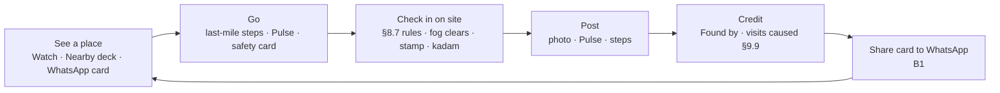
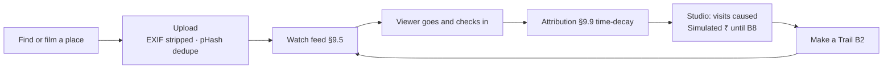
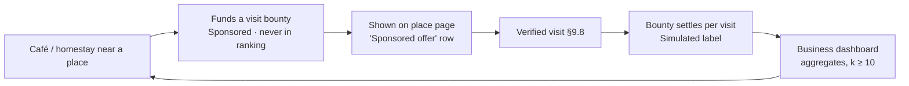
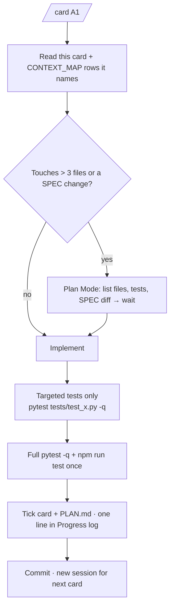

# NEXT_LEVEL_PLAN.md — from submission to start-up

One **card** per Claude Code session. A card says what to read, what to touch,
what to test and when it is done, so a session never has to read all of SPEC.md
or PLAN.md. Why each card exists is in `docs/REVIEW.md`; what to read for a
kind of task is in `docs/CONTEXT_MAP.md`; the prompts are in
`docs/NEXT_PROMPTS.md`.

Rules that still hold for every card: CLAUDE.md invariants 1–13, "Fix the spec,
not the code", tests first for SPEC §9/§10 logic, no new library without asking.

Status: `[ ]` not started · `[~]` in progress · `[x]` done and verified.

---

## 0. The flows

### 0.1 Core loop (the product)



North star: **verified visits caused per week**. A card is worth doing if it
makes this loop faster or more frequent.

### 0.2 Creator loop



### 0.3 Business loop (B6–B7, simulated until B8)



### 0.4 How every card runs (cheap on tokens)



---

## Track A — finish and submit (23–29 October)

No new features in Track A. Order: A6 → A1 → A2 → A5 → A4 → A3 (on site) → A7.

### A1 Security, privacy and fraud review `[x]`
- **Why:** Phase 9 item never run; invariants 1, 5, 7 are the core promise.
- **Read:** CLAUDE.md invariants; SPEC §8.7, §8.14, §9.8, §14 (see CONTEXT_MAP);
  `backend/app/auth.py`, `routers/checkin.py`, `routers/places.py` (fragile path),
  `routers/media_router.py`, `media_store.py`, `main.py`.
- **Do:** run PROMPT.md Prompt 8 as a subagent. Fix every high and medium.
  Add security headers in `main.py` (CSP `default-src 'self'; img-src 'self' data: blob:;
  connect-src 'self' https://tiles.openfreemap.org; …`, `X-Content-Type-Options`,
  `Referrer-Policy: same-origin`, `Permissions-Policy` with geolocation=self).
- **Tests:** one test per fixed finding in `backend/tests/test_security.py`
  (e.g. `test_fragile_place_hides_coords_before_pledge`,
  `test_no_lat_lng_in_logs`, `test_security_headers_present`).
- **Done when:** findings list in `docs/SECURITY_REVIEW.md` with each item fixed
  or justified; `pytest -q` green.

### A2 Tick what is already verified; Lighthouse `[x]`
- **Why:** AC-20/21/22 tests exist (`e2e/screens.spec.ts`, `e2e/accessibility.spec.ts`)
  but PLAN.md shows `[ ]`.
- **Do:** run `npx playwright test`; if green, tick the box. Run Lighthouse
  mobile on Nearby and Watch (Chrome DevTools, production build `npm run build && npm run preview`);
  fix the top 2 issues each; record scores in PLAN.md "Measured values".
- **Done when:** PLAN.md Phase 9 rows ticked with numbers.

### A3 Field measurements (you, outdoors) `[ ]`
- **Do on site** (two places, phone, HTTPS dev server): 10 check-ins → note the
  reported accuracy (m); upload 5 phone photos → note KB after resize; post 1
  video → time to first frame in Watch.
- **Done when:** the three "not yet measured" rows in PLAN.md have values.

### A5 Split the long handlers (behaviour-preserving) `[ ]`
- **Why:** viva readiness; CLAUDE.md "functions ≤ 40 lines where possible".
- **Targets:** `routers/checkin.py:57 check_in` (202 lines),
  `routers/studio.py:227 studio` (186), `routers/watch_router.py:44 get_watch` (173),
  `partner/run.py:108 measure_creator` (150), `routers/deck_router.py:43 get_deck` (139).
- **Do:** one function per commit. Extract named steps (`_validate_checkin_input`,
  `_apply_fraud_flags`, `_award_checkin_kadam`, …) each with a one-line docstring
  citing its SPEC section. No behaviour change; no new tests needed beyond the
  existing ones staying green.
- **Stop rule:** if a split needs more than 30 minutes or breaks a test you
  can't explain, revert that file and move on. The deadline beats tidiness.
- **Done when:** each target ≤ ~60 lines; `pytest -q` green, same count.

### A6 Repo hygiene + CI + commit skill `[x]`
- **Do:** `git rm pagdandi-starter.zip`; fix `.gitignore` (`*-starter.zip`);
  propose a one-line SPEC title/epigraph fix for the Truvel/Pagdandi naming (wait);
  add `.github/workflows/ci.yml` (ruff + pytest on Python 3.12; `npm ci`,
  `npm run lint`, `npm run test` on Node 20; no Playwright in CI yet, it needs
  seeded data); recreate `.claude/skills/commit/SKILL.md` per PROMPT.md Prompt 3.
- **Done when:** CI green on the branch.

### A7 Report, recording, rehearsal, tag `[ ]`
- PROMPT.md Prompts 11, 12 and Prompt 5 (quiz mode). Use `docs/REVIEW.md`
  §2 and §4 for the "future work" chapter. Tag `v1.0-submission`.

---

## Track B — start-up (November onward)

Each B card **starts with a SPEC.md diff** (new section or tier move) and waits
for approval. Cards are in dependency order.

### B0 Foundations for real users `[ ]`
- **SPEC diff:** new §21 "Running in production" (hosting, backups, migrations,
  moderation, data separation).
- **Do (one sub-card per session):**
  1. Alembic migrations generated from current `models.py` (replace
     `create_all` in `db.py:80` for non-test runs).
  2. `DATABASE_URL` config so Postgres + PostGIS works; keep SQLite for tests.
  3. Media storage interface in `media_store.py` (local | S3-compatible); ffmpeg
     transcode to 720p H.264 + poster, still re-encoding images without EXIF.
  4. `backend/app/worker.py`: scheduled jobs (Commons fetch, Pulse expiry, Partner month).
  5. **Data separation for ODbL:** user-contributed places/steps/Pulse in tables
     not derived from OSM rows; document in README "Licences".
  6. Admin moderation queue screen (reports → hide/restore), official account only.
  7. Deploy guide `docs/DEPLOY.md`: one free-tier VM, reverse proxy with HTTPS,
     nightly DB backup off the box, upload size limits at the proxy.
- **Done when:** a fresh VM runs the app from `docs/DEPLOY.md`; migrations up/down tested.

### B1 WhatsApp share cards + deep links + PWA install `[ ]`
- **SPEC diff:** §8.11 Social: share card spec.
- **Backend:** `GET /share/place/{id}.png` (1200×630, Pillow, cached on disk;
  place name via the same display rules as `names.py`, Commons photo with author
  + licence line printed on the card); `GET /p/{id}` returns minimal HTML with
  Open Graph tags then redirects into the SPA. Fragile places: card shows the
  name and region only, never coordinates (invariant 5).
- **Frontend:** "Share" button on Place page, Trail and Passport using
  `navigator.share` with a fallback copy-link button (every gesture has a button).
- **Tests:** `test_share_card_has_attribution`, `test_share_fragile_hides_location`,
  e2e: share button present and keyboard-operable.

```
Share card (1200 × 630)
┌──────────────────────────────────────────────────────┐
│ [ Commons photo, full bleed, dark gradient bottom ]  │
│                                                      │
│  Khajaguda Rocks            ఖాజాగూడ రాళ్ళు           │
│  Hills · Hyderabad · 12 verified visits this week    │
│  Photo: A. Author · CC BY-SA 4.0           TRUVEL ▸  │
└──────────────────────────────────────────────────────┘
```

### B2 Trails + Weekly Trail `[ ]`
- **SPEC diff:** move Trails and Weekly Trail (§8.12) from Tier 2 to the
  launch scope; add models `Trail(id, owner_id, title, note, created_at)`,
  `TrailStop(trail_id, place_id, position, minutes)`.
- **Backend:** `routers/trails.py`: create/edit/delete own trail (≤ 8 stops),
  `GET /trails/{id}`, `GET /trails?city=` ranked by Wilson over saves (§9.1),
  Weekly Trail = top new trail in the city over 7 days.
  Trail completion = verified visits to ≥ 3 stops in 14 days → kadam via
  `kadam.award()` only (invariant 4).
- **Frontend:** `screens/Trail.tsx`, `components/TrailStopRow.tsx`, "Add to
  Trail" on Place page; Trail tab in Explore.
- **Tests:** `test_trail_completion_awards_once`, `test_trail_ranking_wilson`.

```
Trail screen (390 × 844)
┌───────────────────────────────┐
│ ← Trail                 Share │
│ Old City at dawn              │
│ by @localrao · 4 stops · 5 h  │
│ ┌───────────────────────────┐ │
│ │ map strip (MapLibre, pins │ │
│ │ numbered, no borders)     │ │
│ └───────────────────────────┘ │
│ 1 ● Charminar        40 min  │
│ 2 ● Laad Bazaar      60 min  │
│ 3 ● Chowmahalla      90 min  │
│ 4 ○ Mecca Masjid     30 min  │
│ ───────────────────────────── │
│ Progress 3/4 verified  ▓▓▓░   │
│ [ Save ]  [ Start trail ]     │
└───────────────────────────────┘
```

### B3 City launch challenge + campus clans `[ ]`
- **SPEC diff:** §8.12 clans moved to launch scope; new "Challenge" section
  (30-day window, city, metric = fog cleared %, team = clan).
- **Backend:** `Clan(id, name, city_slug, invite_code)`, `ClanMember`; challenge
  leaderboard computed from `Visit` (verified only, simulated visits excluded,
  invariant 8). Reward via `kadam.award()`.
- **Frontend:** Challenge banner on Nearby; clan page with leaderboard (numbers
  via `format.ts`); join by invite code.
- **Tests:** `test_challenge_counts_only_verified_visits`,
  `test_dev_simulated_visits_excluded_from_leaderboard`.

```
Nearby with challenge banner
┌───────────────────────────────┐
│ Clear the fog of Hyderabad    │
│ Day 12/30 · Your clan: CBIT   │
│ City 18 % cleared  ▓▓░░░░░░   │
│ [ Leaderboard ]               │
├───────────────────────────────┤
│        (existing deck)        │
└───────────────────────────────┘
```

### B4 Trip check-out timer (safety) `[ ]`
- **SPEC diff:** move "trip-safety check-out timer" from Tier 3 to launch;
  state clearly: **no coordinates stored or sent** (invariant 1).
- **Backend:** `TripTimer(id, user_id, place_id, contact_email, due_at,
  checked_out_at)`; worker (B0.4) emails the contact via `mailer.py` if not
  checked out by `due_at`: place name + last-mile link, nothing else.
  Contact must confirm once by email link before alerts are allowed.
- **Frontend:** on Place page under the Safety card (which is never hidden,
  invariant 9): "Going now? Set a check-out time" → time picker → "I'm out" button.
- **Tests:** `test_timer_alert_has_no_coordinates`, `test_timer_needs_confirmed_contact`,
  `test_timer_cancelled_on_checkout`.

```
Place page, under Safety
┌───────────────────────────────┐
│ ⚠ Safety & access (always on) │
│ …                             │
├───────────────────────────────┤
│ Going alone?                  │
│ Tell a friend if you're not   │
│ out by  [ 18:00 ▾ ]           │
│ Friend: priya@… (confirmed ✓) │
│ [ Start timer ]               │
└───────────────────────────────┘
```

### B5 Hindi + Telugu UI (native-reviewed) + voice notes `[ ]`
- **Do:** PROMPT.md Prompt 14 for `hi` and `te`; ship only after a named native
  reviewer signs off in `frontend/src/i18n/REVIEWED.md` (invariant 11).
- **Voice:** record up to 60 s on the Write Steps screen; upload as audio media
  (same pipeline, no metadata kept); transcripts made in an offline Colab batch
  with an open Indic speech model, shown as "Auto-transcribed" until the author
  edits it.
- **Tests:** `test_unreviewed_language_not_selectable`, audio magic-byte check.

### B6 Visit bounties for local businesses (simulated) `[ ]`
- **SPEC diff:** new §10.7 "Visit bounties": a business account funds
  `per_visit_paise` × `max_visits` for one place; shown as a *Sponsored offer*
  row on the place page; **never** an input to any ranking (§9.1–9.5);
  settles only on visits passing §9.8 and §9.10; every ₹ via `<Money>` with
  Simulated (invariant 13).
- **Backend:** `Business`, `Bounty`, `BountySettlement` (ledger rows only,
  invariant 4); settlement inside the existing check-in path after fraud flags.
- **Frontend:** `components/SponsoredOffer.tsx` on Place page; business
  dashboard `screens/Business.tsx`.
- **Tests:** `test_bounty_never_affects_rank` (rank identical with and without
  bounty), `test_bounty_settles_only_verified`, `test_bounty_stops_at_cap`.

```
Business dashboard (laptop)
┌──────────────────────────────────────────────────────────┐
│ Banner: Simulated — no real money moves in this version  │
│ Chai Point, near Khajaguda Rocks                         │
│ ┌──────────┐ ┌──────────┐ ┌──────────┐                   │
│ │ Verified │ │ Spent    │ │ Cost per │                   │
│ │ visits 48│ │ ₹960 Sim │ │ visit ₹20│                   │
│ └──────────┘ └──────────┘ └──────────┘                   │
│ Visits by week (bars, text values too)                   │
│ Offer: ₹20 per verified visit · cap 100 · [Pause]        │
└──────────────────────────────────────────────────────────┘
```

### B7 Tourism board footfall dashboard `[ ]`
- **SPEC diff:** §10.2 detailed: aggregate verified visits by place and week
  for one district; **suppress any cell < 10** (k-anonymity); CSV export.
- **Backend:** `GET /board/{district}/footfall?from=&to=` (role-gated account);
  pure function `aggregate_footfall(visits, k)` with docstring + tests.
- **Tests:** `test_footfall_suppresses_small_cells`, `test_footfall_excludes_simulated`.

### B8 Real payouts (only after revenue and legal setup) `[ ]`
- Registered company, bank account, creator KYC, TDS/GST handling and a
  payments partner. `partner.run_month()` unchanged; payout export only.
  The "Simulated" labels come off only in this card, screen by screen, with tests.

---

## Card checklist (copy into each session's final message)

- [ ] Only files named in the card touched (or the plan said why).
- [ ] Targeted tests, then full `pytest -q` and `npm run test`, all green.
- [ ] Invariants 1, 4, 5, 7, 13 re-checked for this change.
- [ ] Card box ticked here; PLAN.md Progress log: one line.
- [ ] 3 viva Q&A appended to `docs/VIVA.md` (Track A) or `docs/DECISIONS.md` (Track B).
- [ ] Committed; next card in a **new** session.
