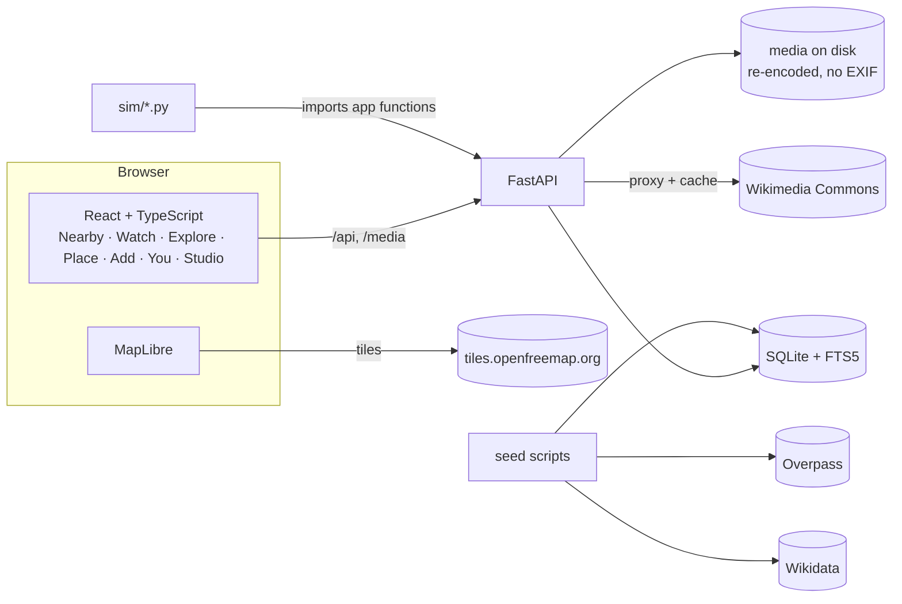

# Truvel — Discover Hidden India

*Applied Data Science and AI project report · submitted 29 October 2026*

Every number in this report is copied from `results/<name>/latest/metrics.json`,
`PLAN.md` "Measured values", or `docs/SECURITY_REVIEW.md`. Simulations are
simulations under stated assumptions, not user studies.

---

## Abstract

Truvel is a travel, social and creator web app for India. It ranks 16,967 real
places from OpenStreetMap and Wikidata, shows their names in 22 Indian languages
plus English in the right script and font, and lets people add the hidden places
that no map knows, verified only when people physically visit them. Five
decisions under uncertainty are made by small, tested algorithms: ranking by
Wilson's lower bound, a Nearby deck personalised by Thompson sampling, a Watch
feed, time-decay attribution of visits to the creators who caused them, and
rules that remove invalid traffic. A creator Partner Program divides a
**simulated** revenue pool mostly by visits caused, not views. In simulation,
Wilson raises precision@10 from 0.356 to 0.452; time-decay attribution reaches
Spearman ρ 0.864 against ground truth; the invalid-traffic rules have precision
1.000 and cut fraud's share of the pool from 0.598 to 0.278. The app never
stores a user's coordinates.

---

## 1. Problem and users

Every Indian city has places that big maps don't list: a rock formation, a
stepwell, a lake path, known only to locals. Visitors see the same top ten.
Creators who show these places are paid for views, which rewards entertainment
rather than usefulness.

| User | Wants | Truvel gives |
|---|---|---|
| Weekend explorer | Something new within 20–30 km, cheap | Nearby deck, Watch, Pulse |
| Local who knows spots | Recognition | "Found by" credit, kadam, levels |
| Travel creator | Audience and income | Watch feed, Studio, Partner Program for real visits |
| Visitor new to a city | Beyond the top 10, in their language | Ranked lists, names in their script, last-mile steps |
| Cautious traveller | Is it safe and accessible? | Safety & access card (never hidden), Pulse |

## 2. Related apps and moat (SPEC §3)

| App | What it does | Where Truvel differs |
|---|---|---|
| Google Maps / Local Guides | Points for reviewing places already mapped | Doesn't find unmapped places; no last-mile steps; no creator income |
| YouTube / Instagram | Creators earn from views | Views reward entertainment; no directions, safety or live conditions |
| Tripoto | Stories; credits for approved posts | Stories, not a verified, ranked, live map |
| Explurger | Check-ins, points, achievements | No verified-visit economy, last-mile steps, fog map or Pulse |
| Atlas Obscura | Editor-reviewed curiosities | Thin everyday coverage of Indian cities |

What is hard to copy: (1) data nobody else has — verified unmapped places,
last-mile steps, live Pulse; (2) money for usefulness — visits caused, not
views; (3) every place name in the scheduled languages; (4) trust — on-site
verification and no stored location.

## 3. Data sources and licences

| Source | Used for | Licence and how it is honoured |
|---|---|---|
| OpenStreetMap (Overpass) | Hyderabad in depth: 296 places, 1,408 areas; `name:*` tags | ODbL; attribution on map and place pages |
| Wikidata (SPARQL) | 16,971 famous places across 34 states/UTs, 26 classes; labels in all languages | CC0; credited |
| Wikimedia Commons | Photos: Wikidata `P18` plus a geosearch within 250 m | Allowlisted only (CC0, PD, CC BY, CC BY-SA); author + licence + link on every photo; 69 candidates rejected; proxied and cached by our server |
| OpenFreeMap | Map tiles | Credited; the only third-party origin the page contacts |

**Why not Google.** Google Places and the Maps JS API are paid and their terms
forbid copying data. The app uses only a plain Google Maps URL for directions
(SPEC §6.6).

Coverage: 7,063 of 16,967 places (41.6 %) have a real photograph; in Hyderabad
245 of 430 (57 %). The rest show a category illustration — no freely licensed
photo exists, and inventing one is not an option.

## 4. Languages

All 22 scheduled languages plus English. A place's name is shown in the user's
chosen language and the local script of its state (SPEC §7.2, `names.py`,
`NameBlock`), with `lang` on every name and right-to-left names inside `<bdi>`.
Fonts are self-hosted (@fontsource) with `unicode-range`, so a page only
downloads the scripts it shows.

Share of places with a name, by language: English 99.5 %, Tamil 22.4, Hindi
17.3, Bengali 15.4, Telugu 12.4, Malayalam 11.8, Punjabi 8.0, Kannada 7.5, Odia
6.8, Marathi 5.0, Gujarati 4.5, Urdu 4.3, Assamese 2.5, Sanskrit 1.5, Nepali
1.1, Maithili 1.1, Santali 1.0, Kashmiri 0.7, Sindhi 0.3, Konkani 0.2, Manipuri
0.1, **Dogri and Bodo 0 %**. The app renders all 23 correctly; *having* a name
is a data gap, not a rendering one. The UI itself ships in English only: other
UI languages ship only after a native speaker reviews them.

## 5. System design

Main tables (SPEC §5): `User`, `Place`, `PlaceName`, `Media`, `LastMileStep`,
`Like`, `Save`, `Follow`, `Swipe`, `CategoryPref`, `Visit`, `Pulse`, `Touch`,
`Attribution`, `KadamEntry`, `EarningPeriod`, `EarningLine`, `Report`,
`Session`. `Visit`, `Pulse` and `Touch` have **no latitude/longitude columns**:
a check-in turns the position into a distance and an accuracy inside one
function call and keeps only those.

Kadam change only through `kadam.award()` / `kadam.reverse()`, and earnings
only through `partner.run_month()` writing `EarningLine`s — ledgers, never a
balance updated in place.

## 6. Algorithms

Each is a small pure function with a docstring citing its SPEC section, and a
test.

**Top — Wilson lower bound (§9.1).** For k likes from n viewers, p̂ = k/n,
z = 1.96: `(p̂ + z²/2n − z·√(p̂(1−p̂)/n + z²/4n²)) / (1 + z²/n)`. A place with
1 like from 1 viewer scores 0.21, not 1.0; 80 of 100 scores 0.71. It ranks by
how sure we are a place is good, not by a lucky small sample.

**Hidden gems (§9.2).** `wilson_lb × {hidden 1.0, known 0.7, famous 0.3}` —
fame measured from Wikidata sitelinks — over verified, non-fragile places.

**Trending (§9.3).** `Σ w · 2^(−age_days/7)` over the last 30 days: likes w=1,
verified visits w=3, Pulse w=1. Half-life one week.

**Nearby deck — Thompson sampling (§9.4).**
`score = 0.40·q + 0.25·e^(−d/4 km) + 0.25·θ_c + 0.10·fresh`, where θ_c is drawn
from Beta(α_c, β_c) per category (save → α+1, skip → β+1). Drawing instead of
using the mean is what makes it explore: an unseen category sometimes draws
high. Then a re-rank so no 3 cards of one category appear in a row.

**Watch ranking (§9.5).** `0.35·quality + 0.20·prox + 0.20·θ_c + 0.15·e^(−age/5 d)
+ 0.10·following`, quality = Wilson on completions over engaged views; at most
2 in a row from one creator.

**Duplicate places (§9.6).** Within 300 m and rapidfuzz `token_set_ratio` ≥ 80
against *every* name in every language (after dropping generic words like
cheruvu/lake/gudi), or within 100 m with the same category. The user decides.

**Photo integrity (§9.7).** 64-bit pHash; Hamming ≤ 8 to another user's photo is
rejected. EXIF GPS > 2 km from the pin is flagged. Every stored image is
re-encoded so no EXIF survives.

**Visit fraud rules (§9.8).** Impossible travel (> 120 km/h between consecutive
visits) flags the visit; new accounts (< 24 h) earn nothing from likes; nothing
for self-dealing; rate limits (10 check-in attempts/hour); a community place is
verified only by 2 unflagged visits from 2 people who aren't its discoverer.

**Time-decay attribution (§9.9).** On a user's first verified visit to a place,
each of their touches in the previous 30 days (page view, engaged video view,
last-mile steps read ≥ 10 s, deck save) gets weight `2^(−age_days/7)`; weights
are summed per creator and normalised to shares that sum to 1.

**Engaged views and invalid traffic (§9.10).** Engaged = ≥ 3 s watched.
Invalid: the creator's own view, an account < 24 h old, a repeat within 24 h,
a simulator session. Velocity hold: views in an hour above `mean + 4·sd` of the
trailing 7 days *and* > 50 are held out of earnings.

**Partner split (§10.3–10.4).**
`score = 1·engaged_views + 25·visits_caused + 5·helpful_votes + 2·confirmed_pulse`;
`amount = pool × score / Σ scores` in paise, rounded down. Eligible creators
only: account ≥ 30 days, no strikes, ≥ 10 verified pieces, and in 90 days
≥ 300 visits caused or ≥ 1,00,000 engaged views. A visit counts 25× a view
because a visit needs a body in a place.

## 7. Evaluation

### 7.1 Simulations (`sim/`, each imports the app's own functions)

| Question | Result |
|---|---|
| Does Wilson put the best places on top? (200 seeds) | precision@10: raw likes 0.042, ratio 0.356 [0.337, 0.375], **Wilson 0.452 [0.433, 0.471]**. Kendall τ: ratio **0.621** beats Wilson 0.554 — Wilson trades tail order for top accuracy |
| Does Thompson sampling help the deck? (50 seeds × 300 users) | First 30 swipes: popular **0.194**, Thompson 0.178 (−8.4 %). Once settled: Thompson **0.155** vs popular 0.145 (+7.0 %). Exploration costs first, pays later |
| Which attribution rule tracks the truth? (100 seeds) | Spearman ρ at truth τ = 10 d: last-touch 0.806, linear 0.830, **time-decay 0.864 [0.846, 0.881]**; time-decay best or near-best for every τ from 2 to 30 days |
| Do the invalid-traffic rules work? (50 seeds) | Precision **1.000**, recall 0.786; fraud's share of the pool 0.598 → **0.278** (−53.6 %) |
| Does pHash catch copies? (50 images) | 100 % re-compress, resize, contrast; 98 % brightness; 46 % watermark; 36 % rotate 3°; 32 % crop 5 %; **0 % crop 20 %**. False matches **0 of 1,225** |

The pHash run used generated stand-in images; the harness says so.

### 7.2 System measurements

| What | Value |
|---|---|
| Explore endpoint, 17k places | top 68 ms · trending 72 ms · nearest 60 ms |
| Deck / Watch / Passport endpoints | 78 ms (budget 200) / 37 ms / 33 ms warm |
| App shell JS | 118 KB gzipped (budget 250 KB) |
| Lighthouse mobile, production build (Nearby / Watch) | Performance 66 / 90 · Accessibility 100 / 100 · Best Practices 92 / 92 · SEO 92 / 91 |
| axe-core serious/critical issues, 9 screens | 0 |
| Tests | backend 247 passing (ruff clean); frontend 26 unit; Playwright suite for AC-20/21/22 green |

### 7.3 Acceptance criteria

Most acceptance criteria (SPEC §18) have a test named after them
(`test_acNN_…` in `backend/tests/`, or a Playwright test in `frontend/e2e/`).
AC-1, AC-2, AC-6, AC-13 and AC-24 are checked by tests and runs not named
after them (seed fixtures, place-page and map screenshots, the simulation
outputs in `results/`), as recorded in `PLAN.md`. AC-20 (no
sideways scroll at 360 px; screenshots in both themes), AC-21 (axe) and AC-22
(only allowed origins contacted) run in Playwright; AC-23 checks that every ₹
carries the Simulated label; AC-25 that the dev simulator is absent from a
production build.

### 7.4 Independent security review (card A1)

A separate reviewer looked for ways to break the privacy and money rules
(`docs/SECURITY_REVIEW.md`). Found and fixed: fragile-place coordinates
recoverable by trilateration from distances (critical); the client could assert
views it never made (high); viewer coordinates reaching plaintext logs (high); a
check-in race that could award twice (high, fixed with a per-user-per-place
lock); a login timing difference revealing which emails exist (medium); the dev
teleport leaking fragile coordinates (medium). pHash's weakness to cropping is
accepted for this version.

## 8. Ethics, privacy, safety, money honesty

- **Location:** used for one request and discarded. No coordinates in the
  database or logs.
- **Media:** every photo and poster re-encoded; no EXIF stored.
- **Fragile places:** exact pin and last-mile steps only after the visitor
  pledges to leave no trace, enforced on the server.
- **Safety:** the Safety & access card is never hidden or collapsed; nothing
  rewards risky content.
- **Money:** no real money moves. Every ₹ is labelled Simulated and Studio
  always shows the banner.
- **No tracking:** the page contacts only our server and the map tiles. No
  analytics, fonts self-hosted, Commons images proxied.
- **Translations:** no machine translation is presented as reviewed.

## 9. Limitations

- The evaluations are **simulations**, not user studies; their conclusions
  hold under their stated assumptions.
- One city (Hyderabad) is seeded in depth; the rest of India has famous places
  only.
- GPS can be spoofed. Fraud rules raise the cost but don't make it impossible.
- The revenue pool is simulated; payouts need a company, KYC, tax handling and
  a payments partner.
- Only the English UI ships; other UI languages wait for native review. Dogri
  and Bodo have no place names in the open data.
- pHash does not survive cropping (0 % at 20 %).
- Large features (a lake, a split park) can survive as duplicates because
  merging compares points, not outlines.
- Not yet measured outdoors: real check-in accuracy, photo size after upload,
  video first-frame time on a phone.

## 10. Roadmap

From SPEC §4 Tier 3 and §10.2, detailed in `docs/NEXT_LEVEL_PLAN.md`:
WhatsApp share cards; Trails (creator playlists); a city-launch challenge with
campus clans; offline city packs; a trip check-out timer that stores no
location; native-reviewed Hindi and Telugu UI; then revenue — clearly labelled
visit bounties from businesses near a place, and aggregate footfall dashboards
for tourism boards — and only then real payouts.

## References

1. E. B. Wilson, "Probable inference, the law of succession, and statistical
   inference," *J. American Statistical Association*, 1927.
2. E. Miller, "How not to sort by average rating," 2009.
3. W. R. Thompson, "On the likelihood that one unknown probability exceeds
   another in view of the evidence of two samples," *Biometrika*, 1933.
4. O. Chapelle and L. Li, "An empirical evaluation of Thompson sampling,"
   *NeurIPS*, 2011.
5. C. Zauner, "Implementation and benchmarking of perceptual image hash
   functions," 2010.
6. OpenStreetMap contributors, ODbL 1.0. Wikidata, CC0. Wikimedia Commons,
   per-file licences.
7. YouTube Partner Program revenue-share terms (SPEC §3, checked October 2026).
8. Web Content Accessibility Guidelines (WCAG) 2.2, W3C, 2023.
